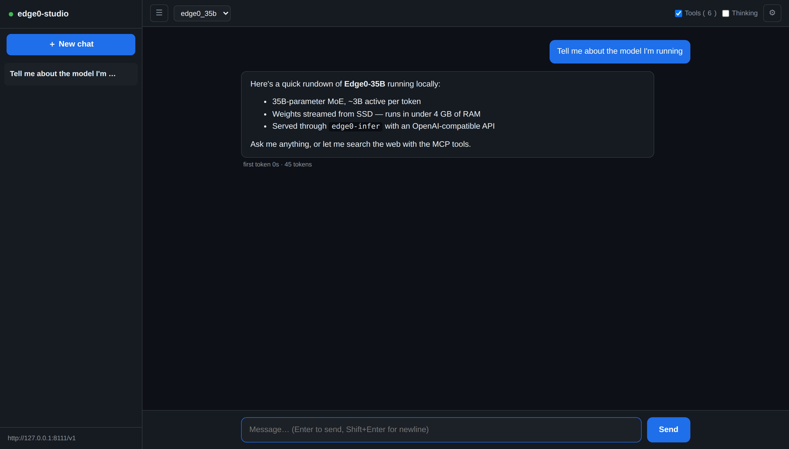

# edge0-studio

A lightweight web UI and **MCP bridge** for [Edge0](https://github.com/Edge0-AI/Edge0)
models served locally by `edge0-infer serve`.



Edge0 gives you an OpenAI- and Anthropic-compatible local server, but no UI and no
tool execution. edge0-studio adds both:

- **Chat UI** — streaming chat in the browser against your local Edge0 model.
- **MCP tools** — connect any [Model Context Protocol](https://modelcontextprotocol.io)
  server (filesystem, fetch, git, …); edge0-studio exposes their tools to the model
  via OpenAI function calling and executes the calls in an agent loop.
- **Thinking view** — optionally show the model's reasoning stream.
- Zero config to start; one YAML file to add tools.

## Requirements

- Python 3.10+
- A running `edge0-infer serve` (see the [Edge0 getting started guide](https://github.com/Edge0-AI/Edge0/blob/main/edge0-infer/docs/getting-started.md))
- `npx` (Node) if you use npm-distributed MCP servers

## Quick start

```sh
# 1. Start your Edge0 model (in the Edge0 repo)
build/cpu/bin/edge0-infer serve --model /path/to/assets-35b --device cpu

# 2. Install and run edge0-studio
pip install -e .          # or: uv sync && uv run edge0-studio
edge0-studio              # opens on http://127.0.0.1:8800
```

Open http://127.0.0.1:8800 — the header shows upstream status and connected
MCP servers.

## Configuration

First run writes `~/.config/edge0-studio/config.yaml`:

```yaml
upstream:
  base_url: http://127.0.0.1:8000/v1   # edge0-infer serve
  model: edge0_35b                     # model alias registered by edge0-infer
  api_key: ""                          # usually empty for local

mcp_servers:
  filesystem:
    command: npx
    args: ["-y", "@modelcontextprotocol/server-filesystem", "/home/me/notes"]
  fetch:
    command: uvx
    args: ["mcp-server-fetch"]
```

Restart edge0-studio after editing. Tools appear in the header count and are
offered to the model automatically; uncheck "MCP tools" to chat without them.

Any OpenAI-compatible server works as the upstream, but the project is built
and tested around `edge0-infer`.

## How it works

```
browser ── SSE ──> edge0-studio (FastAPI)
                      │  OpenAI chat/completions (streaming, tools)
                      ▼
                edge0-infer serve ──> Edge0 model (native engine / edge0-strata)
                      ▲
                      │ tool_calls → MCP stdio sessions → results fed back
```

The agent loop forwards the conversation with the merged MCP tool list, streams
tokens to the browser, executes any `tool_calls` against the owning MCP server,
appends results as `tool` messages, and repeats (max 8 rounds) until the model
produces a final answer.

## Development

```sh
uv sync
uv run edge0-studio --verbose
```

## License

Apache-2.0. Edge0 models are governed by their own
[model license](https://github.com/Edge0-AI/Edge0/blob/main/licenses/edge0-model/LICENSE);
this project only talks to a locally running server and ships no model weights.
